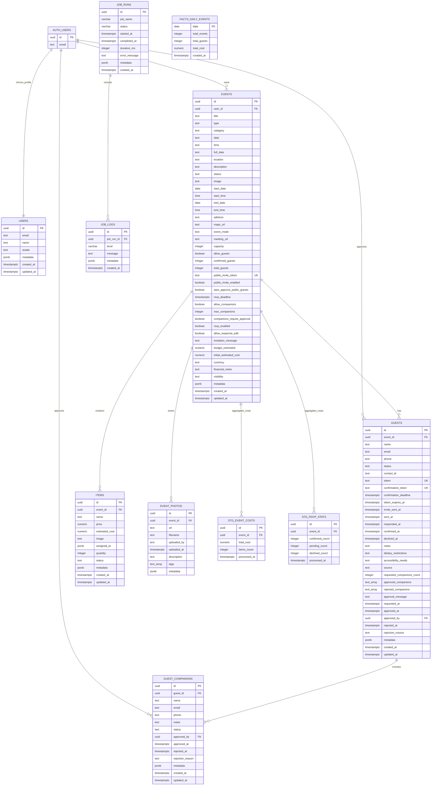

# Diagrama Relacional do Banco de Dados

Este documento descreve o modelo relacional do Planeja+ com base no schema Supabase em `supabase/schema.sql`, nas migrations em `supabase/migrations` e nos tipos/servicos TypeScript do projeto.

Observacoes importantes:

- A tabela de autenticacao `auth.users` pertence ao Supabase Auth e e referenciada pelo schema publico.
- Nao existem tabelas relacionais `contacts`, `item_assignments`, `photos` ou `notification_settings` no schema atual.
- Fotos de eventos ficam em `event_photos`.
- Contatos existem no frontend em `stores/contact-store.ts`, persistidos em localStorage/Zustand.
- A relacao entre convidados e contatos aparece como `guests.contact_id text`, sem chave estrangeira.
- Responsaveis por itens ficam em `items.assigned_to jsonb`, sem tabela `item_assignments`.

## Tabelas e relacionamentos

### `auth.users`

Tabela gerenciada pelo Supabase Auth. Ela e a origem dos usuarios autenticados e e referenciada por `public.users`, `events.user_id`, `guests.approved_by` e `guest_companions.approved_by`.

### `users`

Perfil publico do usuario autenticado. A chave primaria `id` tambem e uma FK para `auth.users(id)`, formando uma relacao 1:1. Guarda `email`, `name`, `avatar`, `metadata` e timestamps.

### `events`

Tabela central dos eventos. Cada evento pertence a um usuario por `user_id -> auth.users(id)`. Um usuario pode ter muitos eventos, entao a cardinalidade e 1:N.

Campos principais: titulo, tipo, categoria, datas, horario, local, status, imagem, configuracoes de RSVP, convite publico, acompanhantes, capacidade, orcamento e visibilidade.

### `guests`

Convidados de um evento. Cada convidado pertence a um evento por `event_id -> events(id)`. Um evento pode ter muitos convidados, entao a cardinalidade e 1:N.

Tambem guarda dados de RSVP, token de confirmacao, status, origem do convite, restricoes alimentares, acessibilidade, notas e dados de aprovacao. A coluna `approved_by` aponta para `auth.users(id)`.

`contact_id` existe como texto, mas nao possui FK para uma tabela `contacts`, pois contatos atualmente vivem no store local do frontend.

### `guest_companions`

Acompanhantes solicitados ou vinculados a convidados. Cada acompanhante pertence a um convidado por `guest_id -> guests(id)`. Um convidado pode ter muitos acompanhantes, entao a cardinalidade e 1:N.

Tambem possui status de aprovacao e `approved_by -> auth.users(id)`.

### `items`

Itens/custos associados a eventos. Cada item pertence a um evento por `event_id -> events(id)`. Um evento pode conter muitos itens, entao a cardinalidade e 1:N.

Campos principais: nome, preco, custo estimado, quantidade, status, imagem e `assigned_to`.

`assigned_to` e `jsonb`; portanto, a atribuicao de responsaveis nao esta normalizada em uma tabela N:N como `item_assignments`.

### `event_photos`

Fotos associadas aos eventos. Cada foto pertence a um evento por `event_id -> events(id)`. Um evento pode armazenar muitas fotos, entao a cardinalidade e 1:N.

Campos principais: URL, nome do arquivo, autor do upload, data de upload, descricao, tags e metadata.

### `job_runs`

Registra execucoes de jobs internos, como agregacoes, limpeza e sincronizacao. Guarda nome, status, horario de inicio/fim, duracao, erro e metadata.

### `job_logs`

Logs de execucao dos jobs. Cada log pertence a um job run por `job_run_id -> job_runs(id)`. Um job run pode ter muitos logs, entao a cardinalidade e 1:N.

### `stg_event_costs`

Tabela de staging para custos processados por evento. Possui `event_id -> events(id)`, total de custo, quantidade de itens e data de processamento.

### `stg_rsvp_stats`

Tabela de staging para estatisticas de RSVP por evento. Possui `event_id -> events(id)` e contadores de confirmados, pendentes e recusados.

### `facts_daily_events`

Tabela de fatos agregados por dia. A chave primaria e `date`. Nao possui FK declarada no schema atual.

## Views materializadas

O schema tambem cria duas materialized views usadas para analytics:

- `mv_event_costs`: agrega custos e quantidade de itens por evento a partir de `events` e `items`.
- `mv_rsvp_stats`: agrega convidados confirmados, pendentes, recusados e total por evento a partir de `events` e `guests`.
