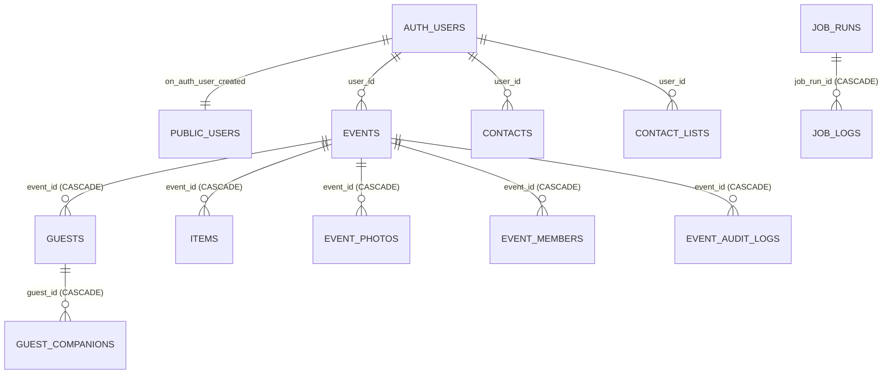
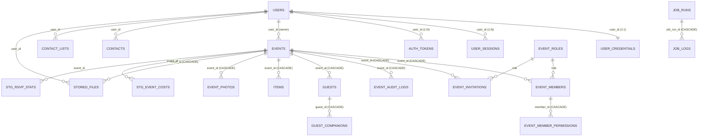

# 02 — Auditoria do Banco de Dados Existente, Nova Modelagem (`planeja_plus`) e Diagramas ER

**Projeto:** Planeja+  
**Banco de Dados Local:** `planeja_plus` (PostgreSQL 16+)  
**Migrations Oficiais:** [001_init_planeja_plus.sql](file:///c:/Users/gabri/Projetos/planejamais/database/migrations/001_init_planeja_plus.sql) e [002_rbac_and_collaboration.sql](file:///c:/Users/gabri/Projetos/planejamais/database/migrations/002_rbac_and_collaboration.sql)

---

## 1. Diagnóstico do Banco Existente (Gerenciado pelo Supabase)

A análise das migrations anteriores (`supabase/migrations/*.sql`) e do arquivo consolidado (`supabase/schema.sql`) revelou:

1. **Acoplamento ao Schema `auth.users` do Supabase:**
   - As tabelas `public.users`, `public.events`, `public.contacts`, `public.contact_lists`, `public.event_members` e `public.event_audit_logs` referenciavam `auth.users(id)` (tabela interna do GoTrue/Supabase Auth).
   - O trigger `on_auth_user_created` dependia de inserções internas do Supabase Auth para popular `public.users`.
2. **Ausência de Tabelas Próprias de Credenciais, Sessões e Tokens:**
   - Como o Supabase gerenciava senhas e JWTs externamente, o schema público não possuía estruturas para hash de senha, controle de tentativas de login (*lockout*), sessões revogáveis ou tokens de recuperação de senha.
3. **Dependência do Schema `storage.buckets` / `storage.objects`:**
   - O upload de fotos referenciava o bucket `event-photos` gerenciado pela API proprietária do Supabase Storage.
4. **Estrutura RBAC (`RN-002`):**
   - Na nova modelagem PostgreSQL local, a estrutura colaborativa foi expandida com tabelas de catálogo e relacionamento normalizadas (`event_roles`, `event_permissions`, `event_members`, `event_member_permissions`, `event_invitations`, `event_audit_logs`), mantendo compatibilidade JSONB em `event_members.permissions`.

---

## 2. Diagrama Entidade-Relacionamento — Estrutura Anterior (Acoplada ao Supabase)

---

## 3. Diagrama Entidade-Relacionamento — Nova Estrutura Independente (`planeja_plus`)

---

## 4. Catálogo Completo das 24 Tabelas do Banco `planeja_plus`

| # | Tabela | Finalidade | Chave Primária | Chaves Estrangeiras e Índices Críticos |
|---:|---|---|---|---|
| 1 | `public.users` | Perfil e identidade dos usuários cadastrados | `id (UUID)` | `email UNIQUE`, `calendar_feed_token UNIQUE`, trigger `trg_sync_public_user_to_auth` |
| 2 | `public.user_credentials` | Hash criptográfico de senha (`$scrypt$`), contador de falhas e bloqueio temporário | `user_id (UUID)` | `REFERENCES public.users(id) ON DELETE CASCADE` |
| 3 | `public.user_sessions` | Sessões autenticadas ativas, IP, User-Agent, expiração e revogação | `id (UUID)` | `user_id REFERENCES public.users(id)`, `token_hash UNIQUE` |
| 4 | `public.auth_tokens` | Tokens de verificação de e-mail e recuperação de senha com expiração e consumo único | `id (UUID)` | `user_id REFERENCES public.users(id)`, `token_hash UNIQUE` |
| 5 | `public.events` | Eventos, modalidade presencial/online/híbrida, regime financeiro e tokens públicos | `id (UUID)` | `user_id REFERENCES public.users(id) ON DELETE CASCADE` |
| 6 | `public.event_roles` | Catálogo oficial dos 5 papéis RBAC (`owner`, `admin`, `collaborator`, `viewer`, `external_host`) | `code (TEXT)` | `hierarchy_level (10..100)` |
| 7 | `public.event_permissions` | Catálogo de permissões por módulo e ação | `id (UUID)` | `UNIQUE (module, action)` |
| 8 | `public.event_members` | Equipe vinculada ao evento, papel, status e matriz de permissões | `id (UUID)` | `idx_event_members_single_active_owner`, `UNIQUE (event_id, lower(email))` |
| 9 | `public.event_member_permissions` | Permissões granulares relacionais por membro da equipe | `id (UUID)` | `member_id REFERENCES public.event_members(id) ON DELETE CASCADE` |
| 10 | `public.event_invitations` | Convites formais para equipe com token hash e prazo de validade | `id (UUID)` | `event_id REFERENCES public.events(id)`, `token_hash UNIQUE` |
| 11 | `public.event_audit_logs` | Histórico imutável de alterações de equipe, permissões e titularidade | `id (UUID)` | `event_id REFERENCES public.events(id) ON DELETE CASCADE` |
| 12 | `public.guests` | Convidados titulares, status de presença, restrições e tokens de RSVP | `id (UUID)` | `event_id REFERENCES public.events(id) ON DELETE CASCADE` |
| 13 | `public.guest_companions` | Acompanhantes vinculados a um convidado titular e status de moderação | `id (UUID)` | `guest_id REFERENCES public.guests(id) ON DELETE CASCADE` |
| 14 | `public.items` | Itens e despesas financeiras do evento com trigger `sync_item_costs` | `id (UUID)` | `event_id REFERENCES public.events(id) ON DELETE CASCADE` |
| 15 | `public.event_photos` | Registros da galeria fotográfica do evento | `id (UUID)` | `event_id REFERENCES public.events(id) ON DELETE CASCADE` |
| 16 | `public.stored_files` | Metadados de arquivos físicos armazenados em volume local com hash SHA-256 | `id (UUID)` | `event_id REFERENCES public.events(id)`, `user_id REFERENCES public.users(id)` |
| 17 | `public.email_outbox` | Fila e auditoria de e-mails enviados via Mailpit ou SMTP externo | `id (UUID)` | `idx_email_outbox_status` |
| 18 | `public.contacts` | Agenda privada de contatos do organizador (`RN-014`) | `id (UUID)` | `user_id REFERENCES public.users(id) ON DELETE CASCADE` |
| 19 | `public.contact_lists` | Listas segmentadas de contatos do organizador | `id (UUID)` | `user_id REFERENCES public.users(id) ON DELETE CASCADE` |
| 20 | `public.job_runs` | Histórico de execução das rotinas automatizadas (`RF-031`, `RF-032`) | `id (UUID)` | `idx_job_runs_status`, `idx_job_runs_job_name` |
| 21 | `public.job_logs` | Logs detalhados por etapa de cada rotina automatizada | `id (UUID)` | `job_run_id REFERENCES public.job_runs(id) ON DELETE CASCADE` |
| 22 | `public.stg_event_costs` | Tabela de staging para consolidação financeira diária | `id (UUID)` | `event_id REFERENCES public.events(id) ON DELETE CASCADE` |
| 23 | `public.stg_rsvp_stats` | Tabela de staging para consolidação diária de presença | `id (UUID)` | `event_id REFERENCES public.events(id) ON DELETE CASCADE` |
| 24 | `public.facts_daily_events` | Tabela fato diária de indicadores agregados | `date (DATE)` | Primary Key `date` |
