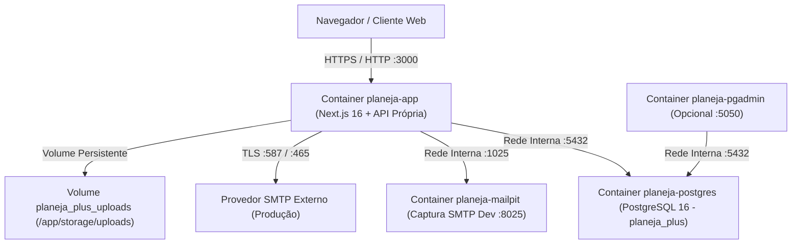

# 03 — Arquitetura da Aplicação, Docker Compose, Autenticação, E-mail, Storage e RBAC

**Projeto:** Planeja+  
**Branch:** `feature/postgresql-local`

---

## 1. Arquitetura Geral Independente do Supabase

---

## 2. Configuração do Docker Compose ([docker-compose.yml](file:///c:/Users/gabri/Projetos/planejamais/docker-compose.yml))

A infraestrutura conteinerizada é composta por 4 serviços orquestrados na rede isolada `planeja-internal`:

1. **`postgres` (`postgres:16.4-alpine`):**
   - Banco `planeja_plus` inicializado automaticamente com as migrations `001_init_planeja_plus.sql`, `002_rbac_and_collaboration.sql` e `001_demo_seed.sql`.
   - Porta vinculada estritamente ao loopback local (`127.0.0.1:5432:5432`), nunca exposta diretamente à internet.
   - Volume persistente `planeja_plus_pgdata`.
   - Healthcheck ativo com `pg_isready`.
2. **`mailpit` (`axllent/mailpit:v1.21.4`):**
   - Servidor SMTP local na porta `1025` e interface web de inspeção de e-mails em `http://127.0.0.1:8025`.
   - Volume persistente `planeja_plus_mailpit`.
3. **`app` (`Dockerfile` multi-stage Node 22 Alpine):**
   - Aguarda `postgres` e `mailpit` atingirem estado `healthy` antes de iniciar.
   - Monta o volume persistente `planeja_plus_uploads` em `/app/storage/uploads`.
   - Monitorado por healthcheck em `GET /api/health`.
4. **`pgadmin` (`dpage/pgadmin4:8.12` — perfil opcional `pgadmin`):**
   - Ativado sob demanda com `docker compose --profile pgadmin up -d`.

---

## 3. Documentação da Autenticação Própria ([lib/auth/auth-service.ts](file:///c:/Users/gabri/Projetos/planejamais/lib/auth/auth-service.ts) e [lib/auth/password.ts](file:///c:/Users/gabri/Projetos/planejamais/lib/auth/password.ts))

### 3.1 Segurança Criptográfica
- **Hash de Senhas:** Formato PHC `$scrypt$n=16384,r=8,p=1$<salt_base64>$<hash_base64>` com salt CSPRNG de 128 bits e verificação em tempo constante (`crypto.timingSafeEqual`). Nenhuma senha é armazenada em texto puro.
- **Proteção contra Força Bruta:** Após `5` tentativas consecutivas inválidas, a conta é bloqueada temporariamente por `15 minutos` (`locked_until` em `public.user_credentials`).
- **Gerenciamento e Revogação de Sessões:** Cada login gera um registro em `public.user_sessions` (com hash SHA-256 do token, IP, User-Agent e expiração de 7 dias) e um cookie `HttpOnly`, `SameSite=Lax` assinado via HMAC-SHA256 (`planeja_session_token`). O logout ou a redefinição de senha marca `revoked_at = now()` no banco, invalidando imediatamente o acesso.

### 3.2 Endpoints da API de Autenticação
| Método | Rota | Descrição |
|---|---|---|
| `POST` | `/api/auth/register` | Cadastra usuário em `public.users` + `public.user_credentials`, dispara e-mail de confirmação e inicia sessão |
| `POST` | `/api/auth/login` | Valida credenciais, aplica trava de tentativas falhas e emite cookie `HttpOnly` `planeja_session_token` |
| `POST` | `/api/auth/logout` | Revoga a sessão ativa em `public.user_sessions` e limpa os cookies de autenticação |
| `GET` | `/api/auth/session` | Retorna o usuário autenticado validando a assinatura JWT e o status ativo da sessão no PostgreSQL |
| `PATCH` | `/api/auth/session` | Atualiza dados do perfil (`name`, `phone`, `location`, `avatar`) ou altera a senha (`action: "change_password"`) |
| `DELETE` | `/api/auth/session` | Exclui a conta do titular e todos os dados vinculados em cascata (conformidade LGPD `RNF-005`) |
| `POST` | `/api/auth/verify-email` | Consome token de verificação de e-mail (`public.auth_tokens`) e marca `email_verified = true` |
| `POST` | `/api/auth/password-recovery` | Gera token de recuperação de senha (validade de 60 min) ou redefine a senha revogando sessões anteriores |
| `GET` | `/api/health` | Diagnóstico em tempo real do banco PostgreSQL `planeja_plus`, migrations, storage e servidor SMTP |

---

## 4. Documentação do Serviço de E-mail ([lib/email/smtp-transport.ts](file:///c:/Users/gabri/Projetos/planejamais/lib/email/smtp-transport.ts) e [src/services/email.service.ts](file:///c:/Users/gabri/Projetos/planejamais/src/services/email.service.ts))

- **Ambientes Suportados:**
  1. **Desenvolvimento Local (Mailpit):** Captura todos os e-mails enviados pela aplicação na porta `1025` para visualização em `http://localhost:8025`. Registra no banco (`public.email_outbox`) com `status = 'captured_mailpit'` e `is_external_delivery = false` (não contabilizando captura local como entrega externa).
  2. **Produção (SMTP Real):** Quando `SMTP_HOST`, `SMTP_USER` e `SMTP_PASS` apontam para um provedor externo (ex: Amazon SES, SendGrid, Gmail SMTP, Brevo), realiza a entrega real via TLS e registra `status = 'sent'` e `is_external_delivery = true`.
- **Reprocessamento Automático:** A função `retryQueuedEmails()` permite reenviar mensagens com status `queued` ou `failed` (`retry_count < 3`).

---

## 5. Documentação do Armazenamento Local de Arquivos ([lib/storage/local-storage.ts](file:///c:/Users/gabri/Projetos/planejamais/lib/storage/local-storage.ts))

- Substitui o Supabase Storage gravando os arquivos fisicamente no diretório persistente `STORAGE_DIR` (`./storage/uploads/<bucket>/`) e registrando metadados e checksum `SHA-256` na tabela `public.stored_files`.
- **Validações de Segurança:**
  - Whitelist estrita de tipos MIME por bucket (`event-photos`, `avatars`, `documents`, `attachments`).
  - Limite máximo de tamanho (`5 MB` para fotos de eventos, `2 MB` para avatares, `10 MB` para documentos).
  - Sanitização de nome de arquivo e bloqueio contra *Path Traversal* (`path.resolve` + verificação de prefixo).
  - Servido por `GET /api/storage/[bucket]/[filename]` com cabeçalho `X-Content-Type-Options: nosniff`.
